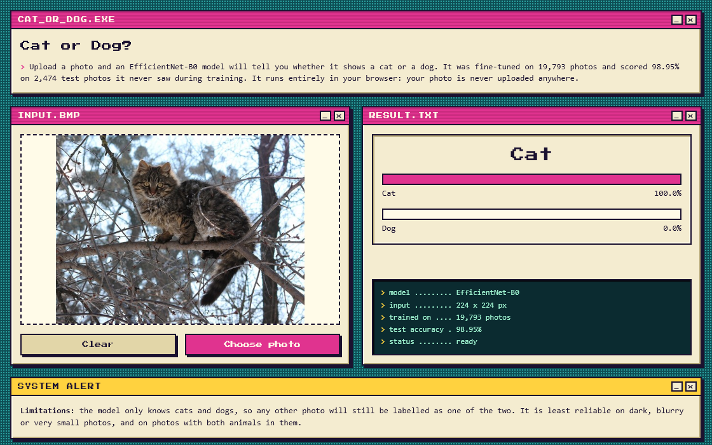
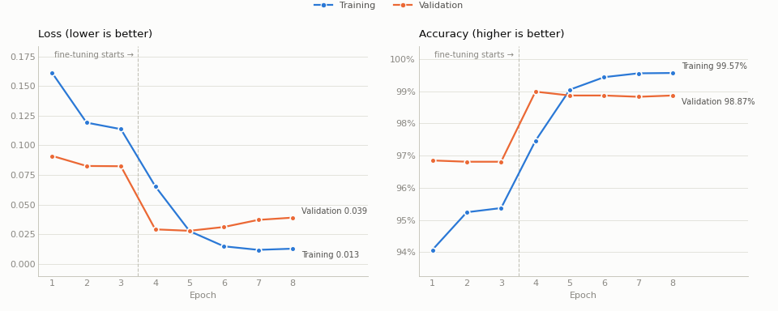
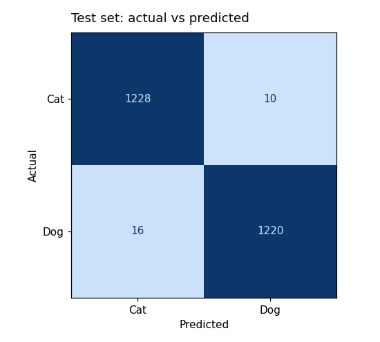

# Cat or Dog? An image classifier from notebook to live app

[](https://github.com/katts-69/cats-vs-dogs-classifier/actions/workflows/tests.yml)
[](https://huggingface.co/spaces/bebird/cat-or-dog)
[](https://huggingface.co/bebird/cats-vs-dogs-efficientnet-b0)

**[Try the live demo →](https://huggingface.co/spaces/bebird/cat-or-dog)**

Upload a photo and the app tells you whether it shows a cat or a dog. The model is an
EfficientNet-B0 fine-tuned in PyTorch, and it scores **98.95% on 2,474 test photos** it never
saw during training. The demo runs entirely in your browser, so your photo is never uploaded.



## Highlights

- **Data cleaning:** found and removed 259 unusable images from the 25,000-image dataset,
  including 229 files that weren't really JPEGs and 28 duplicates. Two of those duplicates were
  labelled as both cat and dog, and duplicates can leak test images into training.
- **Transfer learning in two phases:** first trained only a new output layer on top of an
  ImageNet model, then fine-tuned the whole network with a 10× lower learning rate.
- **Error analysis:** looked at all 26 test mistakes. 5 aren't really model errors, including a
  mislabelled beagle in the dataset.
- **Free deployment:** exported to ONNX and run in the browser with ONNX Runtime Web, hosted as
  a static Hugging Face Space. I checked that the browser version gives the same accuracy.
- **Engineering:** 21 automated tests, a FastAPI REST API, a Docker image, and GitHub Actions
  that run the tests and test the Docker container on every push.

## Contents

1. [The data](#the-data)
2. [The model](#the-model)
3. [Results](#results)
4. [Error analysis](#error-analysis)
5. [How it's deployed](#how-its-deployed)
6. [Run it yourself](#run-it-yourself)
7. [Project structure](#project-structure)
8. [Limitations and future work](#limitations-and-future-work)

## The data

The dataset is Microsoft's [Kaggle Cats and Dogs Dataset](https://www.microsoft.com/en-us/download/details.aspx?id=54765):
25,000 photos, half cats and half dogs, originally from the Asirra CAPTCHA project. It isn't
included in this repo, but [`src/prepare_data.py`](src/prepare_data.py) rebuilds my exact split
from the downloaded zip.

### Cleaning

I decoded and hashed every image before training, and left out 259 of them:

| Problem | Images | Why it matters |
|---|---:|---|
| Not really JPEGs despite the `.jpg` name (173 BMP, 51 GIF, 4 PNG, 1 PSD) | 229 | Unexpected formats can crash or silently corrupt a data pipeline |
| Exact duplicates within a class (one copy kept) | 26 | A copy in training and a copy in test means the test score partly measures memory |
| The same image filed under both Cat and Dog | 2 | Contradictory labels, so all copies were dropped |
| Unreadable, zero-byte files | 2 | Can't be loaded at all |

The remaining 24,741 images were split **80 / 10 / 10**, stratified by class, with a fixed seed.
After splitting, I checked the files on disk: every image is in exactly one split and no
duplicates remain. [`splits/split_manifest.csv`](splits/split_manifest.csv) records where every
image went, or why it was excluded.

| Split | Cats | Dogs | Total | Used for |
|---|---:|---:|---:|---|
| Train | 9,910 | 9,883 | 19,793 | Learning the weights |
| Validation | 1,239 | 1,235 | 2,474 | Choosing the best epoch |
| Test | 1,238 | 1,236 | 2,474 | Final score, used only once at the end |

## The model

**EfficientNet-B0**, pretrained on ImageNet. It has 4.0 million parameters and a 16 MB file,
small enough to run quickly on a CPU or in a browser. ImageNet already contains many cat and
dog breeds, so the pretrained features suit this task well. That's **transfer learning**: reuse
what a model learned on 1.2 million images instead of starting from zero.

I replaced the 1,000-class ImageNet output layer with a 2-class Cat/Dog layer and trained in two
phases:

| Phase | What trains | Learning rate | Epochs | Why |
|---|---|---|---:|---|
| 1. Head only | The new output layer only (2,562 parameters) | 1e-3 | 3 | The new layer starts random. Training it alone first stops its large early errors from damaging the pretrained features |
| 2. Fine-tune | All 4.0M parameters | 1e-4 | 5 | Gently adapt the whole network to cats and dogs, adjusting the pretrained knowledge rather than overwriting it |

Other details:
- **Augmentation:** random crops (70–100% of the image) and horizontal flips, so the model
  learns that a cat is still a cat when zoomed in or mirrored.
- **Training setup:** AdamW and cross-entropy loss, with mixed precision on the GPU for speed.
- **Checkpointing:** the model was saved whenever validation accuracy improved, so the final
  model is the best epoch, not the last.

## Results

| | Score |
|---|---:|
| **Test accuracy** | **98.95%** (2,448 of 2,474) |
| Best validation accuracy | 98.99% (epoch 4) |
| Cat precision / recall | 98.71% / 99.19% |
| Dog precision / recall | 99.19% / 98.71% |



The charts show three things:
- Validation accuracy sat around 96.8% while only the head was training, then jumped to 99%
  in the first fine-tuning epoch.
- **After epoch 5 the model began to overfit.** Training loss kept falling, but validation loss
  rose from 0.028 to 0.039, which means the model was starting to memorise the training photos.
- Checkpointing kept the epoch-4 model, so the overfitting didn't affect the final result. It
  did show that the last epochs weren't needed, so [`src/train.py`](src/train.py) now defaults
  to 2 fine-tuning epochs.



## Error analysis

I looked at all 26 misclassified test images.

**5 aren't really model mistakes:**
- `Cat/4085.jpg` is a **beagle labelled as a cat**. The model said Dog with 100% confidence, so
  the label is wrong, not the model.
- `Dog/8898.jpg` is a "No Photo Available" placeholder, and `Dog/10801.jpg` shows only a dog
  collar. Neither contains an animal.
- `Cat/1450.jpg` and `Dog/8565.jpg` contain both a cat and a dog.

**The other 21 are mostly hard photos:**
- dark animals in poor lighting
- puppies and kittens held so that human hands and faces fill the frame
- small, fluffy or pointy-eared dogs, such as chihuahuas and Pomeranians
- blurry or tiny images

Most of these were predicted with only 51–70% confidence, so the model was unsure rather than
confidently wrong. The exception is `Dog/5231.jpg`, a white Spitz curled up on a carpet, which
the model called Cat with 100% confidence. A fluffy white animal lying curled up is a pose far
more common in cat photos.

Taking out the 5 photos with a wrong or impossible label, the model's accuracy on genuine
cat-or-dog photos is about 99.1%.

## How it's deployed

```
              ┌─────────────────────────────────────────────────────────┐
 PyTorch      │  best_model.pt ──► ONNX export ──► model.onnx (16.8 MB) │
 training     └──────────────────────────┬──────────────────────────────┘
                                         │ hosted on the Hugging Face model hub
                 ┌───────────────────────┴───────────────────────┐
                 ▼                                               ▼
   Live demo: static web page                      REST API: FastAPI in Docker
   HTML + JS + ONNX Runtime Web                    POST /predict → JSON
   the model runs in the visitor's browser         for other programs to call
```

**The live demo** ([`web/`](web/)) is a plain HTML/CSS/JavaScript page. It downloads the ONNX
model once, then classifies photos in the browser with ONNX Runtime Web (WebAssembly). Hugging
Face charges for hosting Python apps on its free CPU tier, but static pages are free. Running
the model in the browser also means photos never leave the visitor's device. To make sure the
conversion didn't change the model:
- [`deploy/export_onnx.py`](deploy/export_onnx.py) compares the ONNX and PyTorch models on all
  2,474 test images: 0 disagreements, with a maximum probability difference of 0.0000027.
- I ran the whole test set through the actual web page in headless Chrome. It also scored
  98.95%.

**The REST API** ([`src/api.py`](src/api.py)) serves the same model to programs instead of
people. It has `GET /health` and `POST /predict`, validates uploads (400 for a non-image, 413
for files over 10 MB), and documents itself at `/docs`. The [`Dockerfile`](Dockerfile)
packages it as a container that:
- uses CPU-only PyTorch;
- has the model built into the image, so it runs offline;
- runs as a non-root user;
- includes a health check.

**Continuous integration** ([`.github/workflows/tests.yml`](.github/workflows/tests.yml)) runs on
every push:
1. The 21 pytest tests in [`tests/`](tests/). They check:
   - probabilities sum to 1;
   - known cat and dog photos are classified correctly;
   - grayscale, transparent, tiny and very wide images don't crash the model;
   - the API returns the right errors.
2. A Docker build, followed by real requests to the running container.

There's also a local [Gradio](https://gradio.app) version of the app, [`app.py`](app.py),
styled the same way as the web page (see [`DESIGN.md`](DESIGN.md)).

## Run it yourself

You need Python 3.11. Clone the repo and install the libraries:

```bash
git clone https://github.com/katts-69/cats-vs-dogs-classifier.git
cd cats-vs-dogs-classifier
pip install -r requirements.txt
```

The trained model downloads automatically from Hugging Face the first time it's needed. To use
it without training anything yourself:

```bash
python -m src.predict photo.jpg                # classify photos from the command line
python app.py                                  # local web app at http://127.0.0.1:7860
python -m uvicorn src.api:app --reload         # REST API, try it at http://127.0.0.1:8000/docs
python -m pytest                               # run the tests
```

Or run the API in Docker:

```bash
docker build -t cats-vs-dogs-api .
docker run --rm -p 8000:8000 cats-vs-dogs-api
curl -F "file=@photo.jpg" http://localhost:8000/predict
# {"label":"Cat","confidence":0.9999,"probabilities":{"Cat":0.9999,"Dog":0.0001}}
```

To train from scratch, download `kagglecatsanddogs_5340.zip` from
[Microsoft](https://www.microsoft.com/en-us/download/details.aspx?id=54765), then:

```bash
python -m src.prepare_data path/to/kagglecatsanddogs_5340.zip   # rebuild the cleaned split
python -m src.train                                             # two-phase training, saves models/best_model.pt
python -m src.evaluate                                          # test accuracy and confusion matrix
```

Training on a GPU needs the CUDA build of PyTorch; see the note at the top of
[`requirements.txt`](requirements.txt). The original exploration, with all the charts, is in
[`notebooks/cats_vs_dogs.ipynb`](notebooks/cats_vs_dogs.ipynb).

## Project structure

```
├── src/
│   ├── prepare_data.py   rebuild the cleaned train/validation/test split from the zip
│   ├── data.py           loading and preparing images (resize, crop, normalise, augment)
│   ├── model.py          EfficientNet-B0 with a 2-class output layer
│   ├── train.py          two-phase training, saves the best validation epoch
│   ├── evaluate.py       test accuracy, per-class report, confusion matrix
│   ├── predict.py        Predictor class and command-line tool
│   └── api.py            FastAPI REST API
├── web/                  the live demo: HTML, CSS and JavaScript with ONNX Runtime Web
├── deploy/               ONNX export and publishing to Hugging Face
├── tests/                pytest tests for the model and the API
├── notebooks/            the original exploration notebook
├── splits/               where each of the 25,000 images went, or why it was excluded
├── docs/                 images for this README
├── app.py                local Gradio app
├── Dockerfile            container image for the API
└── DESIGN.md             visual design notes for the web pages
```

## Limitations and future work

**Limitations:**
- The model only knows two classes. A photo of a rabbit or a car is still labelled cat or dog,
  often with high confidence.
- It is least reliable on dark, blurry or very small photos, on puppies and kittens in people's
  arms, and on photos with both animals.
- Only exact duplicates were removed. Resized or re-encoded copies of the same photo could
  still appear in both training and test, which would inflate the score slightly.
- The dataset has some label noise, like the beagle labelled as a cat.

**Future work:**
- Add a "neither" option, either a third class or a confidence threshold, so other photos
  aren't forced into cat or dog.
- Find near-duplicates with perceptual hashing and re-check the test score.
- Clean up mislabelled training images using the model's own confident disagreements.
- Try test-time augmentation or a larger EfficientNet, and compare speed against accuracy.

## Credits

- Dataset: [Kaggle Cats and Dogs Dataset](https://www.microsoft.com/en-us/download/details.aspx?id=54765)
  by Microsoft Research, from the Asirra project.
- Pretrained weights: [torchvision EfficientNet-B0](https://pytorch.org/vision/stable/models/efficientnet.html),
  trained on ImageNet.
- Test and demo photos: public domain, from Wikimedia Commons (see
  [`tests/images/CREDITS.md`](tests/images/CREDITS.md)).
